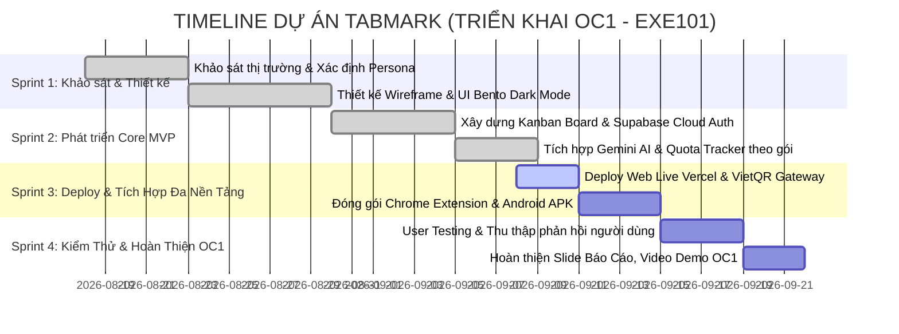

# 📅 TIMELINE & CÔNG CỤ QUẢN LÝ DỰ ÁN (OC1 - TABMARK)

---

## 🛠️ 1. Đề Xuất Công Cụ Quản Lý Dự Án (Project Management Tool)

Nhóm nên lựa chọn **1 trong 2 công cụ phổ biến & trực quan nhất** sau đây để nộp link minh chứng cho Giảng viên:

### 🌟 Lựa chọn 1: Trello (Khuyên dùng - Dễ dùng, Trực quan nhất)
- **Ưu điểm:** Giao diện Kanban kéo thả cực đẹp, dễ phân công task, gắn nhãn (Label màu), hạn chót (Due Date), tạo Checklist trong từng thẻ.
- **Link tạo bảng:** [trello.com](https://trello.com) (Tạo Workspace miễn phí -> Chọn Template "Kanban Template").

### 🌟 Lựa chọn 2: Notion (Chuyên nghiệp - Đa năng)
- **Ưu điểm:** Tích hợp cả Bảng Kanban + Timeline Gantt Chart + Tài liệu họp nhóm trong cùng một trang.
- **Link tạo trang:** [notion.so](https://notion.so).

---

## 📊 2. Cấu Trúc Bảng Quản Lý Dự Án Chuẩn Scrum (5 Cột)

Khi tạo bảng trên Trello hoặc Notion, hãy tạo đúng **5 cột quy chuẩn** này:

```
[ 📥 1. Backlog ] ➔ [ 📝 2. To Do ] ➔ [ ⚡ 3. In Progress ] ➔ [ 🔍 4. Review / Test ] ➔ [ ✅ 5. Done ]
```

### Chi tiết các thẻ công việc (Cards) mẫu để nhóm đưa lên bảng:

| Cột | Các Task cụ thể cần tạo | Người phụ trách mẫu |
| :--- | :--- | :--- |
| **1. Backlog (Ý tưởng & Nghiên cứu)** | - Khảo sát 50 sinh viên về thói quen lưu trữ link học tập<br>- Nghiên cứu đối thủ (Toby, Raindrop, Notion Web Clipper)<br>- Thiết lập chính sách giá 4 gói: Free / 69K / 149K / 299K | Leader / Market Research |
| **2. To Do (Cần làm)** | - Đóng gói Chrome Extension dạng file `.zip`<br>- Xuất file `TabMark.apk` qua Capacitor Android<br>- Quay video demo 2 phút nộp bài | Developer / Mobile Dev |
| **3. In Progress (Đang làm)** | - Deploy Web App lên Vercel Live<br>- Thiết kế Slide thuyết trình OC1 | Frontend / Designer |
| **4. Testing / Review (Kiểm thử)** | - Kiểm thử hạn mức AI gói Free (5 lượt/ngày) & Pro (Unlimited)<br>- Kiểm thử quét mã VietQR tự động kích hoạt gói<br>- Test responsive trên các kích thước màn hình | Tester / QA |
| **5. Done (Đã hoàn thành)** | - Thiết kế giao diện Dark Mode Bento Box Glassmorphism<br>- Tích hợp Supabase Auth (Đăng nhập Google OAuth)<br>- Xây dựng bảng Kanban kéo thả & bộ lọc từ khóa<br>- Tích hợp Gemini AI (Auto-Fill, Smart Summary, Chatbot) | Toàn đội (All Team) |

---

## ⏰ 3. Timeline Dự Án 4 Sprint Chi Tiết (Gantt Chart)



---

## 👥 4. Phân Công Vai Trò Trong Nhóm (Role Assignment)

Để giảng viên thấy sự phối hợp nhịp nhàng, phân chia công việc rõ ràng:

1. **Product Owner / Team Leader:**
   - Quản lý tiến độ trên Trello/Notion, kiểm soát timeline sprint.
   - Thuyết trình bảo vệ đề tài OC1 và giải trình mô hình tài chính.
2. **Frontend & Web Developer:**
   - Phát triển giao diện React + Vite + Tailwind CSS.
   - Deploy sản phẩm lên Vercel và tối ưu hiệu năng.
3. **Backend & AI Engineer:**
   - Cấu hình Supabase (Database, Auth, Row Level Security).
   - Tối ưu Gemini AI API, cơ chế Quota và hệ sinh thái VietQR.
4. **UI/UX Designer & Content:**
   - Thiết kế giao diện Figma, Slide báo cáo thuyết trình.
   - Biên tập nội dung kịch bản video demo 2 phút.
